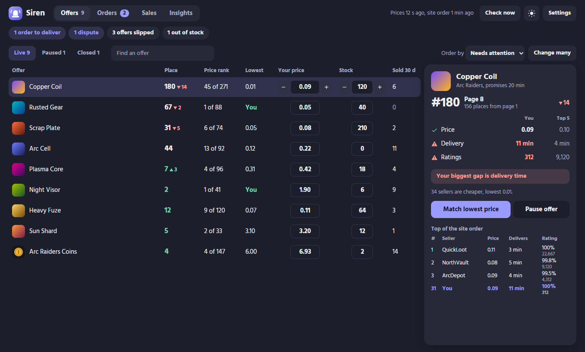
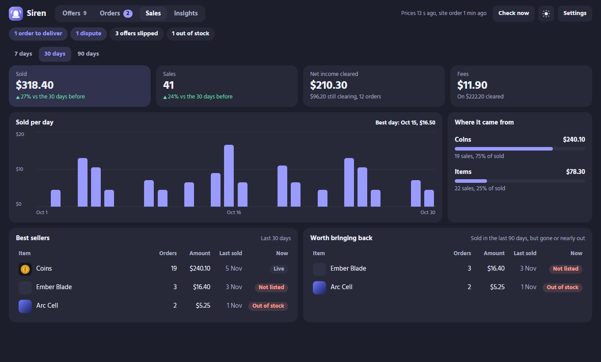
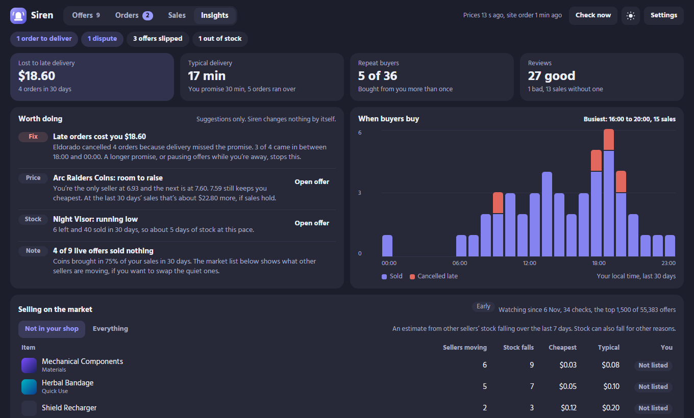

# Windows app

One installer gives you two things:

- **The alarm.** A red window opens above your game and an alarm sound loops until you answer. It listens to your [Eldorado Manager server](getting-started.md) through ntfy.
- **The dashboard.** Your whole shop in one window: offers, rank against other sellers, orders, sales and insights. It talks to Eldorado with your own Seller API key.

Use both, or either one alone. The dashboard needs no server.

| You want | You need |
|---|---|
| Dashboard only | This app and an Eldorado Seller API key |
| PC alarm | This app, plus a running Eldorado Manager server with ntfy as a channel |
| Both | All of the above |

The alarm won't hear Telegram, Discord or Pushover alerts. It listens to ntfy only.

## Install

You need Windows 10 or 11. You don't need admin rights or Python.

1. Download `EldoradoManagerSetup.exe` from the [latest release](https://github.com/229amini/eldorado-manager/releases/latest).
2. Double-click it.
3. Windows may warn that it doesn't recognize the app, because the installer has no paid code-signing certificate. Click **More info**, then **Run anyway**. The source is in [`desktop/EldoradoManager`](../desktop/EldoradoManager), and you can [build it yourself](#build-it-yourself).
4. Fill in Settings. It opens by itself the first time.

To update, run the new `EldoradoManagerSetup.exe` over the old one. Your settings stay. Version 1.2.0 and older installed under an older name; the new installer moves your settings and data over and removes the old app.

## First-time settings

Fill in one tab or both, then click **Save and start**. Eldorado Manager tests each connection before it saves.

**Alarm server**, for the PC alarm. Enter the same ntfy address, topic and token as your server's `.env`. For the dashboard alone, leave the topic empty.

**Eldorado key**, for the dashboard:

1. Open [Dashboard > Seller API](https://www.eldorado.gg/dashboard/seller-api) on Eldorado.
2. Name the credential and pick an expiry. The longest option is 365 days.
3. Click **Generate credentials**, then copy the Client ID and Client secret into Eldorado Manager.

Eldorado shows the secret once. Eldorado Manager encrypts it with your Windows account, so another user or a copied config file can't read it. This key can change your prices, so treat it like a password.

After that, the alarm starts each time you sign in. Open the dashboard from the Start menu: **Eldorado Manager**. Repeat these steps on each PC you use.

**Shared server**, at the bottom of the Eldorado key tab. If you run the Eldorado Manager server, enter its API address and its `DASHBOARD_TOKEN`. Your server then reads the market once for all your PCs, and the **Finance** tab keeps one ledger they all share. Leave it empty and each PC reads the market itself, which can run into Eldorado's rate limit once two or three PCs are open. [Deployment](deployment.md#share-the-api-with-the-windows-app) shows how to publish the API.

## Answer an alarm

Click **Got it**, or close the window. Both tell every device you saw it. Tapping **Got it** on your phone closes the window on your PC.

## Silence the alarm

If another app already rings for your orders, click **Alarm on** at the top of the dashboard. It turns to **Alarm off** and new orders stop ringing on this PC. Click it again to bring the sound back. You can set the same thing under **Settings > Alarm server**. The market estimate keeps running either way.

## The dashboard

The strip under the tabs shows what needs you right now: orders to deliver, disputes, offers that slipped, offers out of stock. When nothing does, it says so.

### Home

The first screen. Four numbers: sold today, orders to deliver, offers on page 1, and what you owe in Finance. Below them:

- **Do now**: open orders, refused edits, offers out of stock or about to run out
- **Price checks**: offers priced below or above the range this week's sales happened in, with a one-click price
- **Sold per day** for the last 14 days, and items other sellers sell that your shop doesn't have

### Offers



Each offer takes one row:

- **Place** is where buyers find the offer in the site's default order. The arrow shows how far it moved since you opened the dashboard.
- **Price rank** counts sellers by price alone. The two often disagree: Eldorado doesn't rank by price.
- **Sold 30 d** comes from your order list.

Type a new price or stock on the row. Eldorado Manager sends it 6 seconds after your last change, or right away when you press Enter. A price change over 50% asks you to confirm.

If Eldorado refuses an edit, the row turns red and keeps the value you typed. A line under it gives Eldorado's reason, with **Send again** and **Discard my change**. When the reason is the rate limit, the app sends it again every 90 seconds until it lands. After a save, the app reads your offers again and checks the new price is there. If Eldorado still shows the old one, the row turns red too.

**Sold at** shows the middle price of the sales other sellers made on the same item this week, with the count under it. Green means your price sits inside the range most of those sales happened in. Red means you're below or above all of it. The side panel draws that range with your price on it, and offers **Set price to** the middle when the data holds enough sales.

Click a row to open the side panel. It compares your price, delivery time and ratings with the top 5 sellers and names your biggest gap.

**Change many** changes one game's prices by a percentage, or its delivery time. You review the list before it sends.

Eldorado closes an offer when its stock runs out. Under **Closed**, type a price and a stock above 0 on the row, then click **Reopen offer** in the side panel. The app sends the stock first, because Eldorado refuses a price on an offer with none, then the price. Some offers need a minimum stock to meet Eldorado's minimum order value; the red line names it.

### Orders

Open orders and the last 30 days, with buyer, amount, deadline, review and dispute. **Mark delivered** and **Extend** act on a real order, so both ask a second time.

### Sales



Pick 7, 30 or 90 days:

- **Sold** counts orders by the day the buyer paid.
- **Net income cleared** is money Eldorado has settled. Orders take about 5 days to clear, so the card also shows what's still on its way.
- **Best sellers** ranks your items and shows each one's state today.
- **Worth bringing back** lists items that sold in the last 90 days but are gone, paused or nearly out.

### Customers

From your own orders of the last 90 days:

- **Top cards**: how many buyers you had, how many came back and what share of your sales they brought, the average order, and the usual gap before a buyer orders again.
- **When orders come in**: a grid of weekday by hour in your local time. Darker cells had more orders.
- **Best buyers** ranks buyers by what they spent, with how often they buy and what.
- **Worth watching** lists buyers with disputes, bad reviews or more than one cancel. A cancel for your late delivery doesn't count against the buyer.
- **Bought together** pairs items the same buyers bought.

### Finance

Finance needs the shared server. It records whose stock each sale was, so you can settle with the people you sell for.

1. Click **Add person** and give each person a name.
2. Under **To assign**, pick an order. Give all its units to one person, or split them, for example 5 to one person and 5 to another. Click **Save**.
3. Click a person to see what they earned, what you paid, and what you still owe. Record each payment there.
4. **Export to Excel** writes their work list for the dates you pick: each order with their units and share, then their payments and balance. **Export everyone** writes one sheet per person and a summary.

A share counts the money after Eldorado's fee, not the order total. Eldorado's order API carries no fee, so your server reads the fee from Eldorado's sales export once an order clears, about 5 days after the sale. Until then it estimates the fee from your recent sales and marks the amount **est**.

### Insights



- **Top cards** show money lost to late delivery, your real delivery time against your promise, repeat buyers and reviews.
- **Worth doing** suggests moves, such as a price with room to rise or stock about to run out. Eldorado Manager changes nothing by itself.
- **When buyers buy** charts sales and late cancellations by hour, in your local time.
- **Selling on the market** estimates demand. See the next section.
- **What your price changes did** compares place and sales before and after each change. It needs a few days of data.

### How the market estimate works

Eldorado publishes no sales numbers per item. So every 30 minutes Eldorado Manager reads the first 1,500 public offers of each listing you sell in, and counts each time another seller's stock falls.

Each row shows the cheapest price listed right now, and two numbers from the falls themselves:

- **Sold at** is the middle price of the sales it saw, one vote per sale. Price near this number when you list the item. The cheapest offer often sits there with no buyers.
- **Most sales** names the offer that sold most and its price. Click it to open that offer on Eldorado and compare its delivery time and ratings with yours.

Both start empty and fill in after the second check.

Read it as a hint. Stock also falls when a seller edits it by hand, and Eldorado Manager sees only the top of a large listing. The list labels itself **Early** until it has a few days of data. Without a shared server it keeps collecting while the alarm runs on this PC, even with the dashboard closed. With one, the server collects for all your PCs around the clock.

## Change settings

Click **Settings** in the dashboard, or open **Eldorado Manager settings** from the Start menu. The moon and sun button switches between Dark and Light.

The dashboard picks its size from your screen, larger on a 1440p or 4K monitor. Press Ctrl and + or - to change it, and Ctrl and 0 to go back. Each PC keeps its own size.

To use your own alarm sound, add a path to a `.wav` file as `"sound"` in `%LOCALAPPDATA%\EldoradoManager\config.json`, then restart the app.

## Known limits

- Rank, lowest price and **Match lowest price** work for offers priced in USD. Public listings show USD only, so the other offers show **USD only** in those columns.
- Sales totals add up every order as USD.
- Eldorado has no call for all your currency offers, so the dashboard asks per game your item offers are in. A seller with currency offers only won't see them yet.
- Eldorado's API has no chat, balance or offer photo calls, so the app doesn't either.
- The maintainer has tested price edits, stock edits, pause, resume and **Reopen offer** on a live account. Deliver, extend and **Change many** follow Eldorado's API reference but haven't run on a live account yet. Try them on a cheap offer first.

## Uninstall

Open **Settings > Apps > Installed apps**, find **Eldorado Manager**, and click **Uninstall**. That removes the app, its settings and its log.

## Troubleshooting

Eldorado Manager writes a log to `%LOCALAPPDATA%\EldoradoManager\manager.log`.

| What you see | What to do |
|---|---|
| No `connected` line in the log | Your ntfy address or token is wrong |
| `connected`, but no alarm | The app's topic differs from `NTFY_TOPIC` on your server |
| Dashboard says it needs WebView2 | Install the [WebView2 Runtime](https://developer.microsoft.com/microsoft-edge/webview2/). Windows 11 has it already |
| `401` from Eldorado | The key has a typo or has expired. Generate a new one and enter it under **Eldorado key** |
| `429` from Eldorado | You've hit Eldorado's rate limit. Eldorado Manager slows down, so wait a few minutes |
| A price is refused | Eldorado takes 2 decimals, or up to 5 below 0.01 |
| The taskbar shows an old icon after an update | Sign out of Windows and back in |

## Build it yourself

You need the [.NET SDK](https://dotnet.microsoft.com/download) and the .NET Framework 4.8 Developer Pack.

```powershell
powershell -ExecutionPolicy Bypass -File desktop\build.ps1
```

The result is `desktop\dist\EldoradoManagerSetup.exe`. On a tagged release, GitHub Actions runs this same script and attaches the exe.
